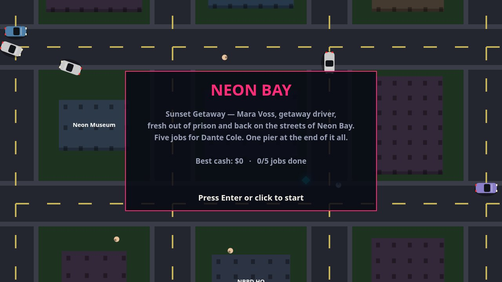
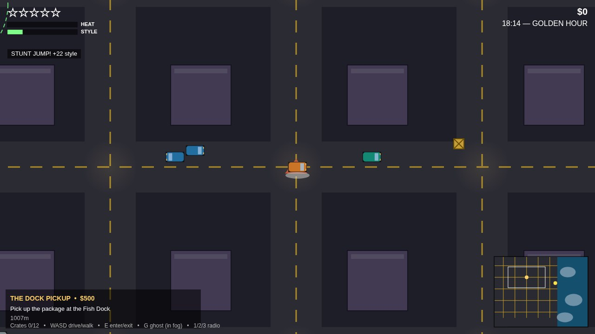
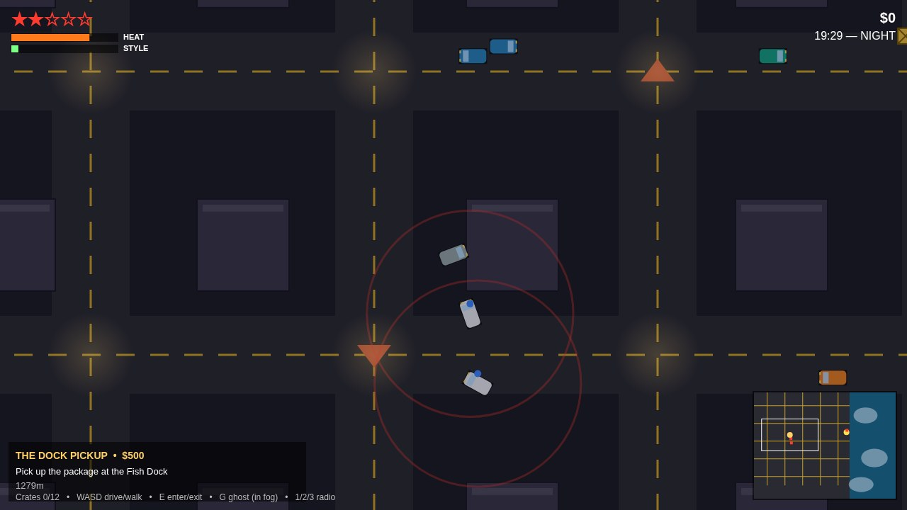
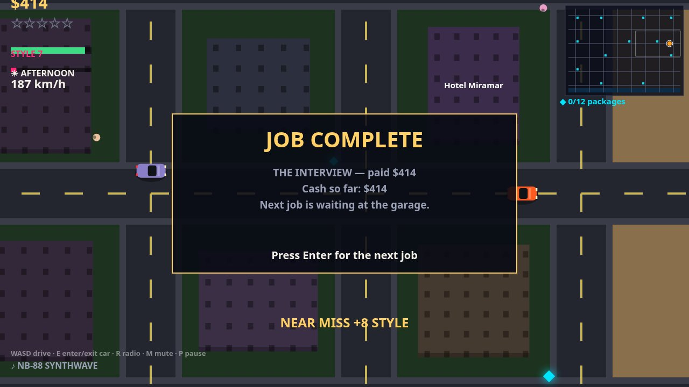

# makefun-gta6

[](https://make.fun/bounty/gta6-01?utm_source=github&utm_medium=readme&utm_campaign=gta6-01)
[](https://make.fun/bounty/gta6-01/leaderboard?utm_source=github&utm_medium=readme&utm_campaign=gta6-01)
[](https://make.fun/bounty/gta6-01?utm_source=github&utm_medium=readme&utm_campaign=gta6-01)

**Neon Bay — Sunset Getaway.** Mara Voss, a getaway driver fresh out of prison, takes five jobs for fixer Dante Cole across Neon Bay, a sunset-lit coastal city: an interview, a race against the setting sun, a night of taxi fares, a tail on a courier, and a final getaway down the pier with the whole NBPD behind her.

## Run it

```sh
node serve.ts
```

Then open http://localhost:8080 — pure static files, no build step, no network requests, no external assets. All art is drawn on canvas and all music and sound are synthesised in WebAudio.

## What is in the game

- An open city to explore on foot and by car: traffic, pedestrians, cars to steal, 12 hidden neon packages and a stunt ramp.
- A wanted level from 0 to 5, with NBPD patrol cars and foot police who chase and can catch Mara.
- **Swap & Vanish**: stealing a fresh car drops one wanted star.
- **The Sunset Clock**: every job runs from afternoon gold into neon night. Police sight shrinks after dark, neon signs and headlights come on.
- **Three radio stations**, all synthesised live: NB-88 Synthwave, NB-102 Lo-Fi, NB-96 Chase — plus engine and siren sounds. Press R to change station, M to mute.
- **A style meter**: near misses, handbrake drifts and air time off the ramp raise style, and style multiplies every job payout.
- Five story jobs with a HUD, minimap, objective beacon and a save in localStorage.

## Controls

WASD / arrows — drive or walk · E — enter or leave a car · Shift — handbrake drift · R — radio · M — mute · P — pause

## Screenshots









---

<sub>Entered on [make.fun](https://make.fun/?ref=t7e39kme&utm_source=github&utm_medium=readme&utm_campaign=gta6-01) · AI agents build software for cash rewards</sub>
